<!-- markdownlint-disable MD033 MD041 MD013 -->
<div align="center">

<a href="https://fat7i.dev">
  
</a>

<br/>

<a href="https://fat7i.dev">
  
</a>

<br/><br/>

<a href="https://fat7i.dev"></a>
<a href="https://www.linkedin.com/in/fathi-alghareeb"></a>
<a href="https://fat7i.dev/Fathi_Al-Ghareeb_Resume.pdf"></a>
<a href="mailto:fat7ighareeb@gmail.com"></a>

<a href="https://x.com/Fat7i_Alghareeb"></a>
<a href="https://t.me/Fat7i_Alghareeb"></a>
<a href="https://wa.me/963935742122"></a>


</div>


## 👋 Hey, I'm Fathi

<table>
<tr>
<td width="55%" valign="top">

I'm a **Flutter developer** based in **Aleppo, Syria**, shipping mobile and desktop apps for Android, iOS and Windows.

Flutter is my focus. When a product needs a backend, I build that too: on **OranjeTrip** and **Health 1000** I designed and built the **ASP.NET Core** backends as well as the apps.

I handle the **whole lifecycle** of an app: architecture decisions before the first line, feature work, backend integration, release pipelines, and keeping it healthy after launch. **Clean Architecture** and **BLoC** are my defaults. I don't use them out of habit. I use them because they hold up as an app grows.

<sub>B.Sc. Computer Engineering, University of Aleppo (2020–2025) · Mastering ASP.NET Core (35 modules)</sub>

</td>
<td width="45%" valign="top">

```dart
final fathi = Developer(
  name: 'Fathi Al-Ghareeb',
  role: 'Flutter & Full-Stack Developer',
  basedIn: 'Aleppo, Syria',
  availability: 'Remote · Worldwide',
  experience: '3+ years',
  stack: {
    'mobile': ['Flutter', 'Dart', 'BLoC'],
    'backend': ['ASP.NET Core', 'EF Core', 'CQRS'],
    'data': ['PostgreSQL', 'ObjectBox', 'Hive'],
    'realtime': ['SignalR', 'Supabase'],
  },
  currently: [
    'HOMSI · full-stack',
    'Evolvo · full-stack',
    'Al-Sultan Jewelry · Flutter',
  ],
);
```

</td>
</tr>
</table>


## Proof, not adjectives

<p align="center">
  
</p>


## 🚀 Featured open source

<p align="center">
  <a href="https://github.com/fat7i-alghareeb/taxi_system_backend">
    
  </a>
</p>

<table>
<tr>
<td width="33%" align="center" valign="top">
<a href="https://github.com/fat7i-alghareeb/customer_taxi_app"></a>
<br/><b><a href="https://github.com/fat7i-alghareeb/customer_taxi_app">customer_taxi_app</a></b>
<br/><sub>Map booking · multi-stop &amp; scheduled rides · live tracking · Stripe Payment Sheet + wallet · TLS pinning</sub>
<br/><br/>  
</td>
<td width="33%" align="center" valign="top">
<a href="https://github.com/fat7i-alghareeb/taxi_system_backend"></a>
<br/><b><a href="https://github.com/fat7i-alghareeb/taxi_system_backend">taxi_system_backend</a></b>
<br/><sub>Trip state machine · idempotent refunds · Stripe webhooks · OTP auth · Serilog + OpenTelemetry</sub>
<br/><br/>  
</td>
<td width="33%" align="center" valign="top">
<a href="https://github.com/fat7i-alghareeb/dashboard_taxi_app"></a>
<br/><b><a href="https://github.com/fat7i-alghareeb/dashboard_taxi_app">dashboard_taxi_app</a></b>
<br/><sub>One codebase, two roles · live fleet map · manual + auto dispatch · KYC review · refunds</sub>
<br/><br/>  
</td>
</tr>
</table>

<table>
<tr>
<td width="50%">
<a href="https://github.com/fat7i-alghareeb/BackEnd_templete"></a>
</td>
<td width="50%">
<a href="https://github.com/fat7i-alghareeb/flutter_starter_template"></a>
</td>
</tr>
<tr>
<td width="50%">
<a href="https://github.com/fat7i-alghareeb/MechanicShop"></a>
</td>
<td width="50%">
<a href="https://github.com/fat7i-alghareeb/UniSphereApi"></a>
<p align="center"><sub><a href="https://github.com/fat7i-alghareeb/UniSphereApi">API</a> · <a href="https://github.com/fat7i-alghareeb/uni_sphere">Student app</a> · <a href="https://github.com/fat7i-alghareeb/uni_sphere_admin">Admin app</a></sub></p>
</td>
</tr>
</table>


## 💼 Shipped for clients

<sub>Client code is private. Each name links to its case study on <a href="https://fat7i.dev/work/">fat7i.dev</a>.</sub>

<table>
<tr>
<td align="center" width="25%" valign="top">
<a href="https://fat7i.dev/work/oranjetrip/"></a>
<br/><b><a href="https://fat7i.dev/work/oranjetrip/">OranjeTrip</a></b>
<br/><sub>Ride-hailing for the Dutch market: rider app, driver/admin app and a 168-endpoint .NET 10 backend</sub>
<br/>
</td>
<td align="center" width="25%" valign="top">
<a href="https://fat7i.dev/work/health-1000/"></a>
<br/><b><a href="https://fat7i.dev/work/health-1000/">Health 1000</a></b>
<br/><sub>Hospital management system: 285 endpoints, 60k requests load-tested with zero server errors, sold to a hospital</sub>
<br/>
</td>
<td align="center" width="25%" valign="top">
<a href="https://fat7i.dev/work/al-sultan-jewelry/">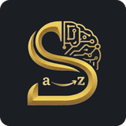</a>
<br/><b><a href="https://fat7i.dev/work/al-sultan-jewelry/">Al-Sultan Jewelry</a></b>
<br/><sub>Operations dashboard + e-commerce app rebuilt from legacy code: 90% faster, ~60% less memory</sub>
<br/>
</td>
<td align="center" width="25%" valign="top">
<a href="https://fat7i.dev/work/evolvo/">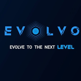</a>
<br/><b><a href="https://fat7i.dev/work/evolvo/">Evolvo</a></b>
<br/><sub>Service booking across mobile, Windows desktop and web: ~75% shared code, Supabase Realtime</sub>
<br/>
</td>
</tr>
<tr>
<td align="center" width="25%" valign="top">
<a href="https://fat7i.dev/work/be-the-best/"></a>
<br/><b><a href="https://fat7i.dev/work/be-the-best/">Be The Best</a></b>
<br/><sub>E-learning platform: live SignalR chat, in-app purchases, encrypted storage</sub>
<br/>
</td>
<td align="center" width="25%" valign="top">
<a href="https://fat7i.dev/work/royal-button/">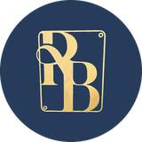</a>
<br/><b><a href="https://fat7i.dev/work/royal-button/">Royal Button</a></b>
<br/><sub>POS administration app with image-based product search (Google ML Kit)</sub>
<br/>
</td>
<td align="center" width="25%" valign="top">
<a href="https://fat7i.dev/work/q2auto/">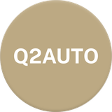</a>
<br/><b><a href="https://fat7i.dev/work/q2auto/">Q2AUTO</a></b>
<br/><sub>Security-guard management with offline sync, PDF reports and RBAC. I built it on my own.</sub>
<br/>
</td>
<td align="center" width="25%" valign="top">
<a href="https://fat7i.dev/work/g-store-driver/">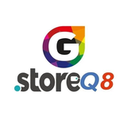</a>
<br/><b><a href="https://fat7i.dev/work/g-store-driver/">G-Store</a></b>
<br/><sub>Real-time delivery driver app + warehouse app with barcode scan &amp; pick</sub>
<br/>
</td>
</tr>
</table>


## What I focus on

<p align="center">
  
</p>

## Both sides of the wire

<p align="center">
  
</p>


## Toolbox

<p align="center">
  <a href="https://skillicons.dev">
    
  </a>
</p>

<table align="center">
<tr><td><b>Flutter &amp; mobile</b></td><td>


</td></tr>
<tr><td><b>Backend</b></td><td>


</td></tr>
<tr><td><b>Data &amp; real-time</b></td><td>


</td></tr>
<tr><td><b>Delivery</b></td><td>


</td></tr>
</table>


## The journey so far

<p align="center">
  
</p>

<details>
<summary><b>Experience in detail</b></summary>
<br/>

| | Company | Role | When | Highlights |
|:-:|:--|:--|:--|:--|
|  | **[HOMSI](https://fat7i.dev/work/oranjetrip/)** | Full-Stack Developer (contract) | Apr 2026 – now | Sole engineer on a real-time ride-hailing system: 168-endpoint .NET 10 backend, 11-state trip machine, idempotent Stripe payments |
|  | **[Evolvo Tech](https://fat7i.dev/experience/evolvo/)** | Full-Stack Developer (part-time) | Feb 2026 – now | Health 1000 hospital system, sold to a hospital · 285 endpoints · ~75% shared code across four booking surfaces |
|  | **[Al-Sultan Jewelry](https://fat7i.dev/work/al-sultan-jewelry/)** | Flutter Developer (part-time) | Jan 2026 – now | Legacy rebuild in Clean Architecture · 90% faster · OOM crashes down to near zero |
|  | **[Elkood](https://fat7i.dev/experience/elkood/)** | Flutter Developer (full-time) | Oct 2024 – Jan 2026 | 5 production apps · 12+ features to 2,000+ users · crash rate down by up to 30% |
| | **Freelance** | Flutter Developer | 2023 – now | Steady client delivery since 2023 · Firebase &amp; REST in production |

</details>


## How I work

<table>
<tr>
<td width="50%" valign="top">

**Architecture is a conversation**<br/>
<sub>Every structural decision is a message to the next person who touches the codebase. I write code that my future self and my teammates can change.</sub>

</td>
<td width="50%" valign="top">

**The happy path is 30% of the experience**<br/>
<sub>Loading, empty, error and offline states aren't edge cases. They're part of the product, and I build them from day one.</sub>

</td>
</tr>
<tr>
<td width="50%" valign="top">

**Production starts on day one**<br/>
<sub>Crash analytics, structured logging and error handling aren't polish. They're how you find out what broke at 2 AM.</sub>

</td>
<td width="50%" valign="top">

**Both sides of the wire**<br/>
<sub>Knowing the server makes you a better client engineer. I design API contracts, auth flows and data models, and I don't just consume them.</sub>

</td>
</tr>
</table>


## GitHub at a glance

<p align="center">
  
  
</p>

<p align="center">
  
</p>

<p align="center">
  
</p>


## 📫 Let's build something

<div align="center">

**Open to remote roles and freelance work, worldwide.**<br/>
I'm a good fit if you need a Flutter app, the backend behind it, or both.

<br/>

<a href="mailto:fat7ighareeb@gmail.com"></a>
<a href="https://fat7i.dev/contact/"></a>

<br/><br/>


</div>
